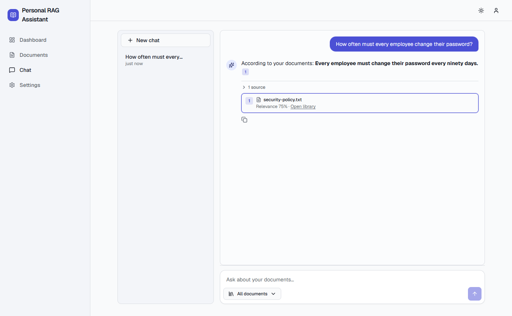
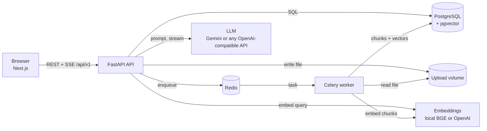
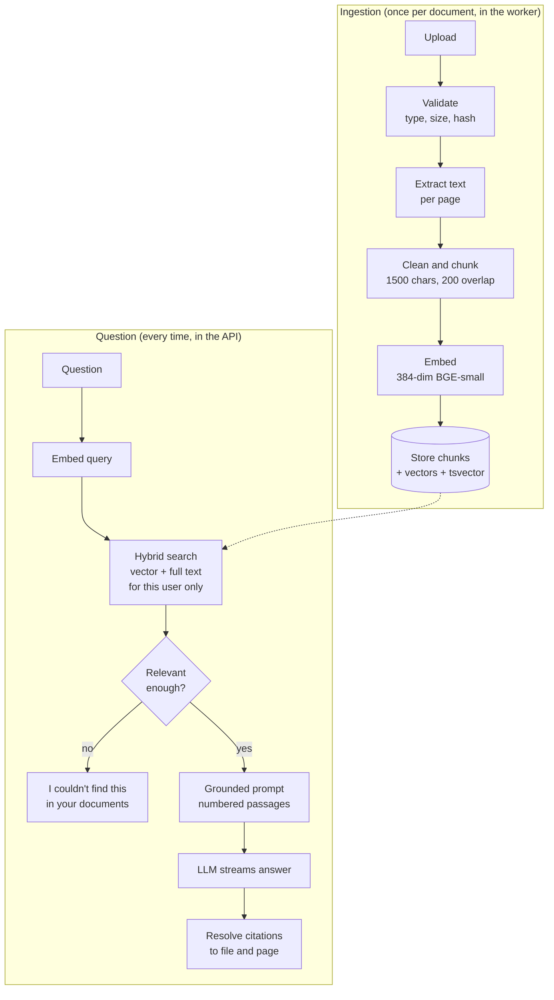
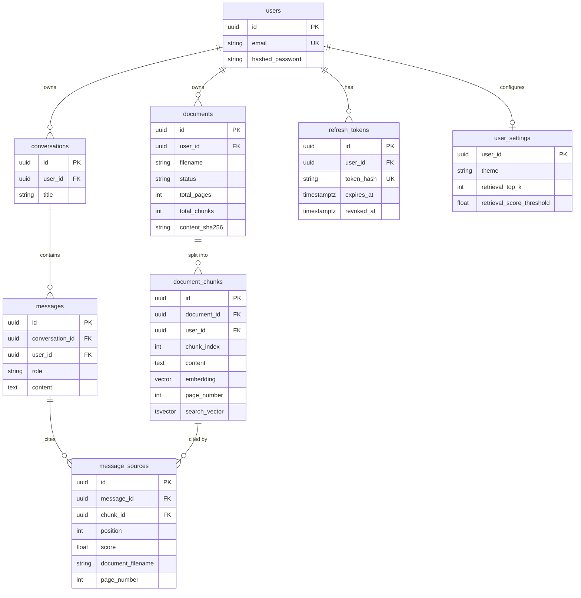
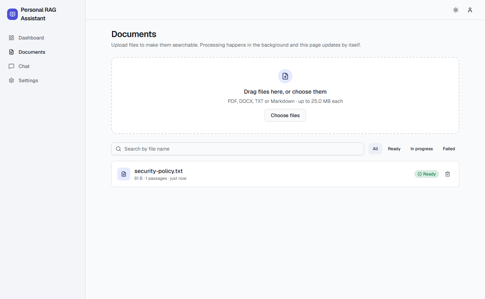
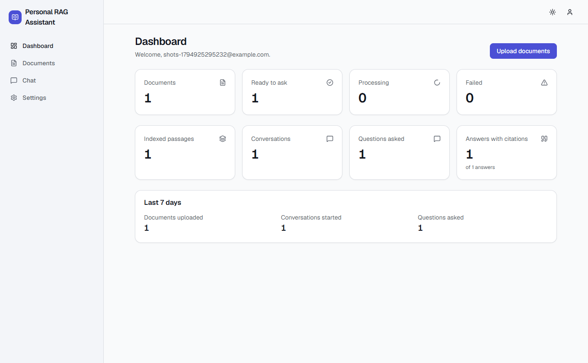
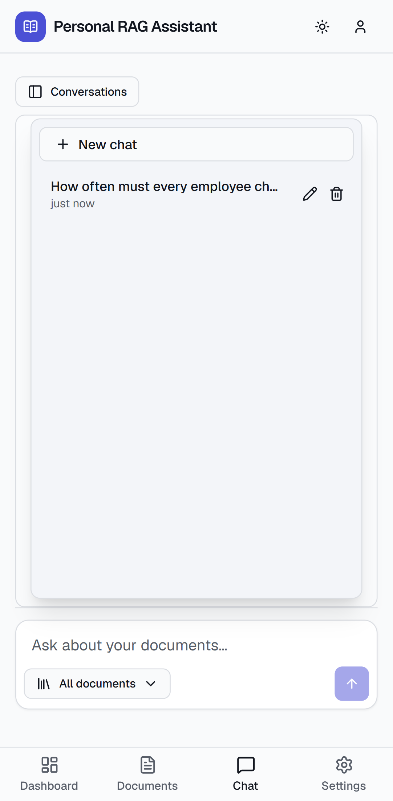

# Personal RAG Assistant

Upload your own documents (PDF, DOCX, TXT, Markdown) and ask questions about them. Answers are
written **only from passages retrieved from your documents**, carry numbered citations
(`[1]`, with file name and page), and stream into a chat that is saved per user. If your
documents do not contain the answer, the assistant says so instead of guessing.

It is a complete, tested full-stack system built as a portfolio project: authentication,
asynchronous ingestion, hybrid semantic + keyword retrieval on PostgreSQL/pgvector, grounded
generation behind a provider-neutral LLM interface, a responsive Next.js interface, and a
hardened Docker Compose deployment.



> **Honest status.** Everything below is covered by automated tests and a CI pipeline that
> also builds and starts the real Docker stack. The screenshots were taken against a
> deterministic **stand-in language model** (it quotes the best retrieved passage), because
> generating real answers needs your own free Gemini key. A run of the finished system with a
> real key has not been recorded here yet; see [Limitations](#limitations-and-future-improvements).

## Contents

[Problem](#the-problem) · [Features](#features) · [Architecture](#architecture) ·
[RAG pipeline](#how-the-rag-pipeline-works) · [Tech stack](#tech-stack) ·
[Database](#database-schema) · [Screenshots](#screenshots) · [Quick start](#quick-start) ·
[Configuration](#configuration) · [Docker](#docker-setup) · [API](#api) ·
[Testing](#testing) · [Deployment](#deployment) · [Limitations](#limitations-and-future-improvements) ·
[Layout](#project-layout) · [Docs](#documentation)

## The problem

Documents pile up (policies, manuals, contracts, notes) and finding one fact means opening
five files. A general chatbot can summarise them, but it will also happily invent details and
you cannot tell which sentence came from where. This project answers from *your* files only,
shows the passage behind every claim, keeps each user's documents private, and refuses when
the evidence is not there.

## Features

| Area | What it does |
|---|---|
| Accounts | Register, log in, refresh and revoke sessions (short-lived access token, rotating refresh token in an HTTP-only cookie) |
| Documents | Upload PDF, DOCX, TXT or Markdown (up to 25 MiB, type checked by content, duplicates rejected), list, status, retry, delete |
| Ingestion | Runs in a Celery worker: text extraction, cleaning, page-aware chunking, embedding, indexing; failures are reported with a safe message and can be retried |
| Retrieval | Hybrid search: vector similarity (pgvector, HNSW) fused with PostgreSQL full-text search by Reciprocal Rank Fusion; optional lexical reranker; relevance threshold |
| Answers | Grounded prompt, `[n]` citations resolved to file and page, "I couldn't find this in your documents." when nothing relevant is found |
| Chat | Persisted conversations, follow-up questions, streaming over server-sent events, rename and delete |
| Isolation | Every query is scoped by `user_id`; the database itself rejects rows whose owner differs from their parent's |
| Interface | Desktop and mobile layouts, documents page with live status, chat with sources, dashboard with usage numbers, settings |
| Operations | Request ids, structured logs, rate limits, security headers, hardened containers, dependency audits |

## Architecture

A modular monolith: one FastAPI codebase run as two processes (API and Celery worker) that share
models and services. The browser talks only to the Next.js origin, which proxies `/api/v1/*`.



Inside the backend the layers only point downwards: routers (HTTP only) → services (business
rules, transactions) → repositories (all SQL, every method takes the user id) and pipeline
stages (loaders, chunker, embedder, retriever, LLM) behind small interfaces. Tests replace the
embedder, the LLM and the repositories with in-memory fakes. The full design, every decision
with its reason and the sequence diagrams are in [docs/architecture.md](docs/architecture.md)
and [docs/decisions.md](docs/decisions.md).

## How the RAG pipeline works



1. **Extract and chunk.** PyMuPDF, python-docx and plain-text loaders produce text per page.
   Text is cleaned and split into overlapping chunks that remember their page number.
2. **Embed.** Each chunk becomes a 384-dimensional vector with `BAAI/bge-small-en-v1.5`, which
   runs inside the worker (about 130 MB, downloaded on first use). OpenAI embeddings are
   available behind the same interface.
3. **Retrieve.** The question is embedded and two rankings are produced for the signed-in user:
   nearest vectors (cosine, HNSW) and PostgreSQL full-text matches. They are merged with
   Reciprocal Rank Fusion, so a paraphrase ("login secret rotation") is found by meaning and an
   exact code (`E-4471`) is found by words. The measured effect is in
   [docs/evaluation.md](docs/evaluation.md).
4. **Gate.** Passages below `RETRIEVAL_SCORE_THRESHOLD` are dropped. If none remain, the model is
   not called and the "not found" answer is returned.
5. **Generate.** The model receives numbered passages, strict rules (answer only from them, cite
   as `[n]`, say so when they do not contain the answer) and a window of recent conversation. The
   answer streams token by token.
6. **Cite.** `[n]` markers are matched to the passages that were actually supplied; a marker
   that does not exist is dropped rather than shown. Sources are saved with the message.

## Tech stack

| Layer | Choice |
|---|---|
| Frontend | Next.js 16 (App Router), React 19, TypeScript, Tailwind CSS 4; Vitest and Playwright for tests |
| API | Python 3.13, FastAPI, Pydantic v2, SQLAlchemy 2 (async), Alembic |
| Background work | Celery with Redis |
| Database | PostgreSQL 17 with pgvector (HNSW cosine index) and full-text search (GIN) |
| Embeddings | sentence-transformers `BAAI/bge-small-en-v1.5` (local, free) or OpenAI |
| LLM | Any OpenAI-compatible API; Google Gemini free tier by default |
| Packaging | Docker Compose (db, redis, migrate, backend, worker, frontend), uv, GitHub Actions |

## Database schema



Ownership cascades downwards; `user_id` is deliberately repeated on chunks and messages and tied
to the parent by a composite foreign key, so a row owned by someone else cannot exist. Column
details, indexes and the citation-survival rule are in
[docs/architecture.md §7](docs/architecture.md).

## Screenshots

All screenshots use the synthetic demo dataset (see [demo/](demo/README.md)) and the stand-in
language model described above, so the wording of the answers is not representative of Gemini.

| Chat with sources | Documents |
|---|---|
|  |  |

| Dashboard | Chat on a phone |
|---|---|
|  |  |

## Quick start

You need **Docker with Compose v2** (about 4 GB of free disk for images and the embedding
model). Nothing else. In GitHub Codespaces this is already set up
(`.devcontainer/devcontainer.json`).

```bash
git clone https://github.com/datacanvas7/Personal-RAG-Assistant.git
cd Personal-RAG-Assistant
cp .env.example .env
docker compose up --build --wait
```

The first start builds the images and applies the database migrations. When it returns, open:

| What | Where |
|---|---|
| Application | http://localhost:3000 |
| API documentation (Swagger) | http://localhost:8000/api/v1/docs (hidden when `ENVIRONMENT=production`) |
| Health | http://localhost:8000/api/v1/health (503 when a dependency is down) |

**Load the demo documents** (four fictional files, created for this repository):

```bash
python scripts/seed_demo.py
```

The script uses only the Python standard library. It creates `demo@example.com`, uploads the
files, waits until they are processed (the first document downloads the embedding model) and is
safe to run again. Sign in at http://localhost:3000 with the credentials it prints, then ask
the questions listed in [demo/README.md](demo/README.md).

**Turn on answers.** Retrieval, search and the whole interface work without a key, but
generating answers needs a language model. The default is Google Gemini, which has a free tier:
create a key at https://aistudio.google.com/apikey, put it in `.env` as `LLM_API_KEY=...`
(never commit it) and restart (`docker compose up -d`). Model names change often, so check what
your key can use:

```bash
docker compose run --rm backend python -m app.scripts.check_llm
```

If it warns that the model is not available, set `LLM_MODEL` in `.env`. Another
OpenAI-compatible service (Groq, OpenRouter, OpenAI, a local Ollama) only needs `LLM_BASE_URL`,
`LLM_MODEL` and `LLM_API_KEY`. The text of the passages found for a question is sent to that
service.

Stop with `docker compose down`; add `--volumes` to delete the database, uploads and the model
cache.

### Windows long paths

On Windows, `uv sync` or `npm ci` can fail with "path too long" when the repository lives in a
deeply nested folder (for example inside a synced OneDrive tree). Clone to a short path such as
`C:\src\rag`, or enable long paths once from an administrator PowerShell and restart:

```powershell
New-ItemProperty -Path "HKLM:\SYSTEM\CurrentControlSet\Control\FileSystem" -Name LongPathsEnabled -Value 1 -PropertyType DWORD -Force
git config --global core.longpaths true
```

Running only `docker compose` does not need either, because the build happens in Linux
containers; it matters when you develop outside Docker.

## Configuration

Everything is configured by environment variables; `.env.example` lists every one with a
comment, and the application refuses to start with an unsafe or inconsistent combination.
The ones you are most likely to touch:

| Variable | Default | Meaning |
|---|---|---|
| `JWT_SECRET_KEY` | placeholder in `.env.example` | Signs access tokens. **Replace it** (`python -c "import secrets; print(secrets.token_urlsafe(48))"`); production refuses the placeholder |
| `LLM_API_KEY`, `LLM_MODEL`, `LLM_BASE_URL` | Gemini, empty key | The language model; without a key `/ask` and chat answer 503 |
| `EMBEDDING_PROVIDER`, `EMBEDDING_MODEL` | local BGE-small | Changing the model needs `python -m app.scripts.reindex` |
| `RETRIEVAL_MODE`, `RETRIEVAL_TOP_K`, `RETRIEVAL_SCORE_THRESHOLD`, `RETRIEVAL_RERANK` | hybrid, 5, 0.45, off | How passages are found and filtered (top-K and threshold can also be overridden per user in Settings) |
| `CHUNK_SIZE_CHARS`, `CHUNK_OVERLAP_CHARS` | 1500, 200 | Chunking |
| `RATE_LIMIT_ENABLED` and friends | on | Per-IP and per-account limits (Redis); fails open if Redis is down |
| `ENVIRONMENT` | `development` | `production` turns on HSTS, hides API docs, and refuses to start unless `COOKIE_SECURE=true` and the secrets are not the `.env.example` placeholders |
| `LOG_FORMAT` | `text` | `json` for log collectors |

## Docker setup

`docker-compose.yml` starts six services:

| Service | Image | Role |
|---|---|---|
| `postgres` | `pgvector/pgvector` (PostgreSQL 17) | Data and vectors; healthcheck; volume `pgdata`; published on `127.0.0.1:5432` |
| `redis` | `redis:8-alpine` | Task queue and rate-limit counters; published on `127.0.0.1:6379` |
| `migrate` | backend image | One-shot `alembic upgrade head`; the API and worker wait for it |
| `backend` | backend image | FastAPI on port 8000 (bound to `127.0.0.1`) |
| `worker` | backend image | Celery worker running ingestion; shares the `uploads` and `models` volumes |
| `frontend` | Next.js standalone build | Port 3000, proxies `/api/v1/*` to the backend |

Containers run as a non-root user with a read-only root filesystem, `cap_drop: ALL`,
`no-new-privileges` and tmpfs for scratch space. Useful commands:

```bash
docker compose logs -f backend worker      # follow logs
docker compose ps                          # health of every service
docker compose run --rm backend python -m app.scripts.reindex   # after changing the embedding model
```

## API

All endpoints live under `/api/v1`, return JSON, and report errors uniformly as
`{"error": {"code": "...", "message": "..."}}`. Authenticated endpoints expect
`Authorization: Bearer <access_token>`. The interactive reference is the Swagger UI
(development) or the OpenAPI schema generated from the code.

| Method and path | Purpose |
|---|---|
| `POST /auth/register`, `/auth/login` | Create an account; obtain an access token (refresh token is set as a cookie) |
| `POST /auth/refresh`, `/auth/logout` | Rotate or revoke the refresh token |
| `GET /users/me` | Current user |
| `POST /documents/upload` | Upload a file; returns `202` and a document in `pending` |
| `GET /documents`, `/documents/{id}`, `/documents/{id}/status` | List (paged), read, poll processing |
| `POST /documents/{id}/retry`, `DELETE /documents/{id}` | Re-run a failed ingestion; delete with its chunks and file |
| `POST /search` | Semantic + keyword search over your documents (POST keeps the query out of URLs) |
| `POST /ask` | One-shot grounded answer with sources |
| `POST/GET/PATCH/DELETE /chat/conversations…` | Manage conversations |
| `POST /chat/{id}/messages`, `/chat/{id}/stream` | Ask in a conversation; the second streams server-sent events (`token`, then `done` or `error`) |
| `GET/PATCH /settings` | Per-user theme, top-K and relevance threshold |
| `GET /analytics/overview` | Counts and usage for the dashboard |
| `GET /health` | Postgres, pgvector and Redis status |

A short session with curl (after `docker compose up`):

```bash
BASE=http://localhost:8000/api/v1
curl -s -X POST $BASE/auth/register -H 'Content-Type: application/json' \
  -d '{"email":"me@example.com","password":"a-long-passphrase"}'
TOKEN=$(curl -s -X POST $BASE/auth/login -H 'Content-Type: application/json' \
  -d '{"email":"me@example.com","password":"a-long-passphrase"}' | python -c "import sys,json; print(json.load(sys.stdin)['access_token'])")
curl -s -X POST $BASE/documents/upload -H "Authorization: Bearer $TOKEN" -F "file=@report.pdf"
curl -s -X POST $BASE/ask -H "Authorization: Bearer $TOKEN" -H 'Content-Type: application/json' \
  -d '{"question": "How often must I change my password?"}'
# {"answer": "Every 90 days [1].", "grounded": true, "sources": [{"number": 1, "filename": "policy.pdf", "page_number": 3, ...}]}
```

## Testing

| Suite | What it covers | Command |
|---|---|---|
| Backend unit | Services, retrieval, prompt building, auth, rate limits, config rules, with in-memory fakes; no database needed | `cd backend && uv run pytest` |
| Backend integration | Real PostgreSQL + pgvector: migrations, repositories, user isolation, ranking | runs when `POSTGRES_DB` ends in `_test` (CI does this) |
| Frontend unit | Components and API client | `cd frontend && npm test` |
| Browser (Playwright) | Register, upload, chat, citations, mobile layout, against the real API with a stand-in model | `cd frontend && npm run e2e` |
| Compose smoke test | CI builds the images, starts the stack, runs auth, upload → embed → search with the **real** embedding model, per-user isolation and the demo dataset | `.github/workflows/ci.yml` |
| Static checks | `ruff`, `mypy`, ESLint, `tsc`, `pip-audit`, `npm audit` | see below |

```bash
cd backend  && uv sync && uv run pytest && uv run ruff check . && uv run ruff format --check . && uv run mypy app tests alembic
cd frontend && npm ci && npm run lint && npm run typecheck && npm test && npm run build
```

Retrieval quality is measured, not asserted: [docs/evaluation.md](docs/evaluation.md) compares
vector, keyword and hybrid search on 44 questions (hybrid never misses), explains what the
numbers cannot show, and gives the one command that reproduces them. Answer quality
(groundedness, citation correctness) is **not** measured, because that needs a language model
as judge.

## Deployment

This repository ships a Compose file meant for a single host. To put it on the internet:

1. **Secrets.** Set `ENVIRONMENT=production`, a long random `JWT_SECRET_KEY`, a strong
   `POSTGRES_PASSWORD`, `COOKIE_SECURE=true` and your `LLM_API_KEY` in the host's environment or a
   secrets manager, not in git. Production startup fails on placeholder secrets or insecure cookies.
2. **HTTPS.** Put a reverse proxy (Caddy, Traefik, nginx) in front of port 3000 and terminate TLS
   there; only the frontend needs to be public. The API port is bound to localhost on purpose.
   The refresh cookie is `Secure` (`COOKIE_SECURE=true`) and HSTS is sent in production.
3. **Persistent storage.** Keep the `pgdata`, `uploads` and `models` volumes on durable disks.
   For several hosts, replace the local `StorageBackend` with an S3-compatible one (the interface
   exists; the adapter is future work).
4. **Backups.** Back up the database (`pg_dump`) **and** the `uploads` volume together; the
   database holds chunks and vectors but the files are the source of truth for re-indexing.
5. **Monitoring.** Scrape `/api/v1/health` for liveness, ship the JSON logs (`LOG_FORMAT=json`;
   every line carries a request id), and wire an error tracker through the existing hook.

The step-by-step guide, with example commands for each point, is
[docs/deployment.md](docs/deployment.md); runtime behaviour (logging, rate limits, headers,
known gaps) is in [docs/operations.md](docs/operations.md).

## Limitations and future improvements

Known and deliberate:

* **Answers with a real model are not recorded in this repository.** Retrieval is measured and
  the answer pipeline is tested with a stand-in model, but no transcript of real Gemini answers
  is published. Run the demo with your own key to see them.
* **The relevance threshold (0.45) was not tuned on real documents.** It is a starting point; if
  good questions are refused, lower it in Settings or `.env` (`RETRIEVAL_SCORE_THRESHOLD`).
* **Scanned PDFs are rejected** with an "OCR required" message; OCR is not included.
* **Evaluation is small and synthetic** (44 questions, 18 short documents).
* **The page Content-Security-Policy still allows `'unsafe-inline'`** for Next.js hydration
  scripts; a nonce-based policy is the fix.
* **No error tracker is installed**, only the hook for one; the rate limiter fails open if Redis
  is unreachable.
* **Not built, on purpose:** e-mail verification and password reset, malware scanning of
  uploads, per-user storage quotas, multi-factor authentication ([full list](docs/operations.md)).
* **No licence file** has been chosen for the repository.

Ideas, roughly in order of value: see [docs/roadmap.md](docs/roadmap.md), which covers a
cross-encoder reranker, OCR, S3 storage, sharing documents between users, answer-quality
evaluation with an LLM judge, and a nonce-based CSP.

## Project layout

```
backend/              FastAPI API + Celery worker (one codebase, one image, two commands)
  app/api/v1/         HTTP routers
  app/services/       Business rules
  app/repositories/   All SQL
  app/ingestion/      Loaders, chunker, pipeline      app/rag/        Prompting, citations
  app/retrieval/      Hybrid search, reranker         app/llm/        Provider adapters
  alembic/            Migrations                      tests/          Unit, integration, e2e server
frontend/             Next.js app (app/, components/, lib/, e2e/)
demo/                 Fictional demo documents and the questions to try
scripts/              seed_demo.py
docker/, docker-compose.yml, .devcontainer/, .github/workflows/
docs/                 Design, decisions, evaluation, operations, deployment, roadmap, screenshots
```

## Documentation

| Document | Contents |
|---|---|
| [docs/architecture.md](docs/architecture.md) | Full design, data flows, schema, threat model |
| [docs/decisions.md](docs/decisions.md) | The main technical decisions and what was traded off |
| [docs/evaluation.md](docs/evaluation.md) | Retrieval experiments and their limits |
| [docs/operations.md](docs/operations.md) | Logging, rate limiting, headers, containers, known gaps |
| [docs/deployment.md](docs/deployment.md) | Putting it on a server |
| [docs/roadmap.md](docs/roadmap.md) | What is next |
| [docs/PROGRESS.md](docs/PROGRESS.md) | Phase-by-phase build log and Definition of Done |
| [docs/interview.md](docs/interview.md) | Talking points for explaining the project |
| [docs/demo-script.md](docs/demo-script.md) | A 4-minute demo video script |
| [demo/README.md](demo/README.md) | The demo dataset and its questions |
