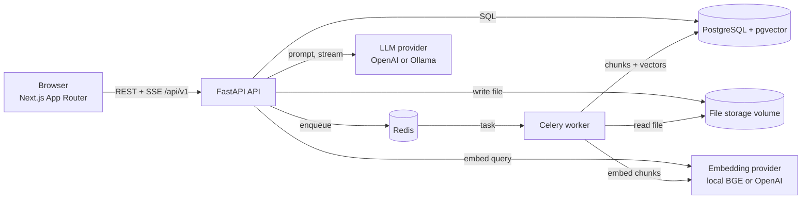
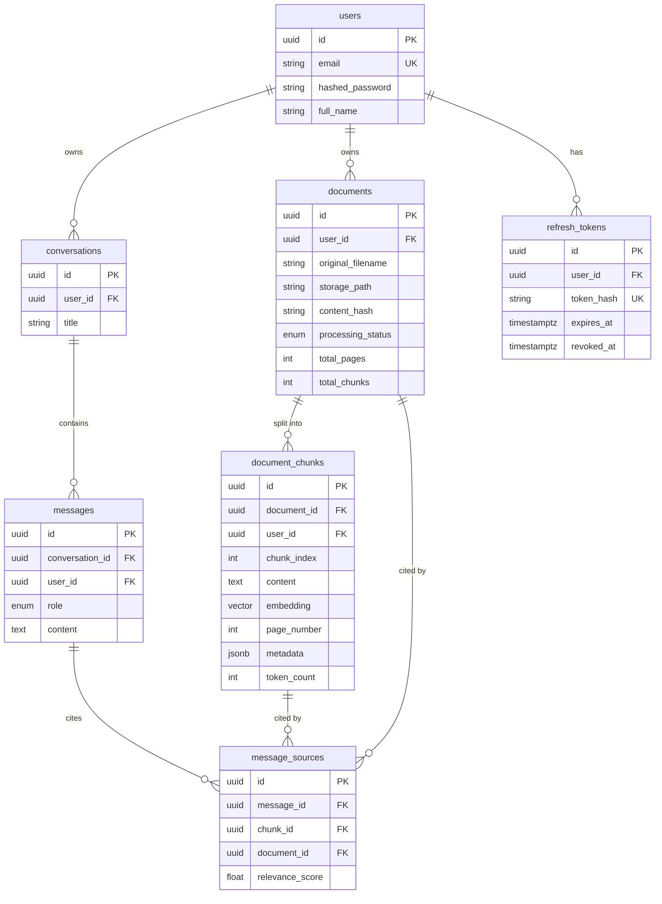

# Architecture — Personal RAG Assistant

Status: **Phase 0 (planning) — awaiting approval.** Nothing in this document is implemented yet.
Last updated: 2026-11-13.

This document records what we are building, how the pieces fit, and *why* each
decision was made. Detailed per-topic docs (`rag-pipeline.md`, `database-design.md`,
`api-reference.md`, …) are written in the phase that implements them.

---

## 1. What we are building

A multi-user web application where a user uploads PDF / TXT / Markdown / DOCX files and
asks questions about them. Answers are generated by an LLM **only from retrieved passages
of that user's own documents**, and every answer carries citations (file, page, excerpt).

Three properties drive the design:

1. **Grounding** — the model answers from retrieved context or says it cannot.
2. **Isolation** — one user can never retrieve another user's content; enforced in SQL.
3. **Replaceability** — LLM, embedding model, and retrieval strategy sit behind our own
   interfaces so each can be swapped without touching the rest.

---

## 2. Development environment (inspected 2026-11-13)

| Item | Found | Needed | Verdict |
|---|---|---|---|
| OS | Windows 11 Pro, domain-joined, **non-admin** shell | — | Installs that need elevation require IT/admin |
| CPU / RAM | i5-8350U (4c/8t), 15.8 GB, no GPU | — | Fine for the app; local LLMs will be slow |
| Disk | **C: 7.3 GB free, D: 3.2 GB free** | ~15–20 GB | **Blocker** — see below |
| Git | 2.55 | any | OK (repo not initialised yet) |
| Node / npm | 24.22 / 11.19 | Node 20+ | OK |
| Python | 3.10.0 only | 3.12+ | **Must install** (no admin needed via `uv`) |
| Docker / Compose | not installed | required | **Blocker** |
| WSL2 | not installed (hypervisor is present) | required by Docker Desktop | **Blocker**, needs admin |
| uv, pnpm, gh, Ollama, psql, redis-cli | not installed | uv recommended; rest optional | Install as needed |
| `OPENAI_API_KEY` | not set | only for OpenAI provider | Local alternative planned |
| Windows long paths | disabled | recommended | `node_modules` can exceed 260 chars |
| Ports 3000 / 8000 / 5432 / 6379 | free | free | OK |

### Blockers to resolve before Phase 1

1. **Docker.** Docker Desktop needs WSL2, and both need administrator rights on a
   domain-joined machine. Options, in order of preference:
   - **A. Docker Desktop locally** (ask IT / use an admin account). Best experience.
   - **B. GitHub Codespaces** (or any Linux VM). The repo's `docker compose up --build`
     runs there unchanged; you edit in the browser or VS Code. Solves disk *and* admin.
   - **C. No local Docker**: write the Compose stack anyway and verify it in GitHub
     Actions, while developing against hosted Postgres+pgvector and Redis free tiers.
     Workable but the weakest loop; Celery is also not officially supported on Windows.
2. **Disk space.** A realistic footprint is 10–15 GB (Docker Desktop + WSL image,
   Postgres/Redis/backend/frontend images, `node_modules`, embedding model, optional
   Ollama model). 10.5 GB total free across both drives is not enough for option A.
3. **Python 3.12+.** Install `uv`, then `uv python install 3.13` (user-scope, no admin).
   The backend itself always runs in the container's Python; the host interpreter is
   only for editor tooling and running unit tests outside Docker.

### Package versions

Latest stable on the registries on 2026-11-13 (candidates; exact pins are fixed in
lockfiles in Phase 1 after a compatibility check, not copied blindly from this table):

| Frontend | Version | Backend | Version |
|---|---|---|---|
| next | 16.4.x | fastapi | 0.162.x |
| react | 19.3.x | pydantic | 2.14.x |
| tailwindcss | 4.3.x | sqlalchemy | 2.1.x |
| @tanstack/react-query | 5.107.x | alembic | 1.20.x |
| zod | 4.6.x | langchain | 1.5.x |
| react-hook-form | 7.92.x | celery / redis-py | 5.7.x / 8.1.x |
| typescript | 7.0.x (verify Next support, else previous major) | pymupdf | 2.1 |
| @playwright/test | 1.65.x | sentence-transformers | 6.3.x |
| | | psycopg | 3.3.x |
| | | pgvector (python) | 0.5.x |

Note: the brief says "SQLAlchemy 2.0", read here as "2.x-style API"; current stable is 2.1.
Several of these are major versions newer than common tutorials (LangChain 1.x, Zod 4,
Tailwind 4, PyMuPDF 2, OpenAI SDK 3) — each is checked against its current docs in the
phase that first uses it.

---

## 3. System architecture

A **modular monolith**: one FastAPI codebase deployed as two process types (API and
Celery worker) sharing the same models and services. No microservices — the domain is
small, and a single codebase keeps transactions and refactoring simple. Module
boundaries are enforced by interfaces, so a module could be extracted later.



### Backend layering

```
api/v1 routers   → HTTP only: parse, authenticate, call a service, shape the response
services         → business rules and transactions (DocumentService, ChatService, …)
repositories     → all SQL; every method takes the authenticated user_id
rag / ingestion / embeddings / retrieval / llm → pipeline stages behind Protocols
models / schemas → SQLAlchemy tables / Pydantic request-response contracts
```

Routers never touch the database or LangChain directly. Dependencies are wired with
FastAPI's `Depends`, which is also what lets tests substitute fakes for the LLM and
embedding providers.

### Provider abstractions

| Interface | Methods | Initial implementations |
|---|---|---|
| `DocumentLoader` | `load(path) -> list[PageText]` | PDF (PyMuPDF), DOCX, TXT, Markdown |
| `EmbeddingProvider` | `embed_documents`, `embed_query`, `dimension`, `model_name` | SentenceTransformers (BGE-small), OpenAI |
| `VectorStore` | `insert`, `delete_by_document`, `search(user_id, …)` | pgvector via SQLAlchemy |
| `Retriever` | `retrieve(user_id, query, filters) -> list[RetrievedChunk]` | Semantic; Hybrid (Phase 9) |
| `Reranker` | `rerank(query, chunks)` | No-op; cross-encoder (Phase 9) |
| `LLMProvider` | `generate`, `stream` | OpenAI, Ollama |
| `StorageBackend` | `save`, `open`, `delete` | Local volume (S3-compatible later) |

---

### Decisions added during Phase 1

| # | Decision | Why |
|---|---|---|
| 17 | **The browser talks only to the Next.js origin.** `next.config.ts` rewrites `/api/v1/*` to the backend (`BACKEND_INTERNAL_URL`, a Docker build argument because Next bakes rewrites into the build). | No CORS in the normal path, no API URL in client code, and the Phase 2 refresh cookie stays first-party. CORS remains available through `BACKEND_CORS_ORIGINS`. |
| 18 | **Frontend image uses `output: "standalone"`**; Compose runs the production build. Hot reload uses `npm run dev` against the published API port. | Small, realistic runtime image; the dev loop is not slowed by bind mounts through Docker. |
| 19 | **`/health` returns 503 with a full body** when Postgres, pgvector, or Redis is unreachable; driver errors go to the log, never into the response. | Orchestrators act on the status code; the body still tells a developer which dependency failed. |
| 20 | **Python 3.13, TypeScript 5.x.** The architecture review suggested TypeScript 7 as a candidate; the Next.js 16.4 scaffold targets 5.x, so it stays there until Next documents support. | Avoid fighting the framework's own toolchain. |
| 21 | **Test client uses `httpx2`.** Starlette deprecated `httpx` for its test client. | "Avoid deprecated APIs." |

## 4. Key decisions and their reasons

| # | Decision | Why | Alternative rejected |
|---|---|---|---|
| 1 | **LangChain is used inside adapters only** (text splitters, chat-model and embedding wrappers). Application code depends on our Protocols. | LangChain's API moves quickly; confining it means an upgrade touches a handful of files. | LangChain chains/agents end-to-end — couples every layer to it. |
| 2 | **Retrieval SQL is written by us** (SQLAlchemy + `pgvector`), not LangChain's `PGVector` store. | We must guarantee `WHERE user_id = :uid` in the query itself, control the schema via Alembic, and later fuse with full-text search. LangChain's store owns its own tables. | `langchain-postgres` vector store. |
| 3 | **One active embedding model per deployment.** Dimension is fixed in the column type (`vector(N)`); model name + dimension are recorded in the DB and checked at startup; switching models is an explicit re-index script. | pgvector indexes need a fixed dimension, and vectors from different models are not comparable. | Per-row model with mixed dimensions. |
| 4 | **Default embeddings: local `BAAI/bge-small-en-v1.5` (384-d)**, OpenAI `text-embedding-3-small` as the alternative. | Works with no API key, free, good quality for its size, deterministic in tests. Runs on CPU. | OpenAI-only — blocks development without a key. |
| 5 | **Default LLM: OpenAI; Ollama as local option**; model names are config. Automated tests use a fake `LLMProvider`. | Matches the brief; no network or cost in CI. The specific default model is chosen in Phase 5 from current docs. | Hard-coding a model. |
| 6 | **psycopg 3 for both API (async) and worker (sync).** | One driver, one set of behaviours; pgvector has a psycopg adapter. | asyncpg + psycopg2 — two drivers to keep in step. |
| 7 | **Auth: short-lived access JWT (≈15 min) sent as `Authorization: Bearer`, held in memory; refresh token in an `httpOnly`, `SameSite` cookie, rotated on use, stored hashed in a `refresh_tokens` table.** Argon2id for passwords. | Access token is not readable from storage by injected scripts for long; logout and theft detection need server-side revocation, which pure stateless JWT cannot do. | Both tokens in `localStorage`; or no revocation. |
| 8 | **Streaming = Server-Sent Events over `POST`**, consumed with `fetch` + a stream reader. Events: `token`, `sources`, `done`, `error`. | Browser `EventSource` cannot POST or send an auth header. SSE is simpler than WebSockets for one-way output. | WebSockets. |
| 9 | **Page-aware chunking**: split within page boundaries (~800 tokens, 150 overlap, both configurable); very short pages may merge forward, recording `page_start`/`page_end` in metadata. | Citations need trustworthy page numbers. | Splitting the concatenated document — loses provenance. |
| 10 | **Ingestion is idempotent and atomic**: the worker claims a document with a conditional status update, and replaces chunks (delete + bulk insert + status update) in one transaction. | Retries and duplicate deliveries cannot create duplicate or partial indexes. | Insert-as-you-go. |
| 11 | **HNSW cosine index plus a b-tree on `user_id`**, with pgvector iterative scan enabled for filtered queries. | Filtered approximate search can otherwise return fewer than K rows. At personal scale the planner will often choose an exact scan, which is fine and perfectly accurate. | IVFFlat (needs training data, worse recall/ops trade-off here). |
| 12 | **Hybrid search = Postgres full-text (`tsvector` + GIN) fused with vector results by Reciprocal Rank Fusion** (Phase 9). | No extra infrastructure; RRF needs no score calibration. | Separate search engine. |
| 13 | **No-evidence short-circuit**: if nothing passes the similarity threshold, return a fixed "not found in your documents" answer without calling the LLM. | Cheapest and most reliable way to prevent fabricated answers. | Always calling the LLM. |
| 14 | **Citations are numbered context blocks** (`[1]`, `[2]` …); the backend parses the markers and maps them to stored chunks, discarding any marker that does not correspond to a retrieved chunk. | The model cannot cite something we did not retrieve. | Trusting free-text citations. |
| 15 | **Dependency management: `uv` + `pyproject.toml` + lockfile** (a `requirements.txt` is exported for compatibility); npm with `package-lock.json`. | Reproducible, hash-locked installs. | Hand-maintained `requirements.txt`. |
| 16 | **UUID primary keys.** | IDs appear in URLs; they must not be enumerable. | Serial integers. |

---

## 5. Data flow: from PDF upload to AI answer

### 5.1 Ingestion (asynchronous)

```mermaid
sequenceDiagram
    participant U as Browser
    participant A as FastAPI
    participant S as File storage
    participant D as Postgres
    participant Q as Redis
    participant W as Celery worker
    participant E as Embedding provider

    U->>A: POST /documents/upload (multipart, Bearer token)
    A->>A: validate extension, magic bytes, size, non-empty; sha256
    A->>S: save as {user_id}/{uuid}.pdf (never the user's filename)
    A->>D: INSERT documents (status = pending), COMMIT
    A->>Q: enqueue ingest(document_id)
    A-->>U: 202 Accepted + document
    Q->>W: deliver task
    W->>D: UPDATE status = processing WHERE status IN (pending, failed)
    W->>S: open file
    W->>W: extract per page → clean → chunk (page-aware)
    W->>E: embed chunks in batches
    W->>D: one transaction: DELETE old chunks, INSERT chunks + vectors, status = completed
    U->>A: GET /documents/{id}/status (polling)
    A-->>U: completed, total_pages, total_chunks
```

Failure handling: permanent errors (malformed file, scanned PDF needing OCR) set
`failed` with a user-safe message and are not retried; transient errors (embedding API
timeout) retry with exponential backoff. A rollback leaves zero chunks, never a partial
set. Pages with too little extractable text are counted; if the document is mostly
image-only it fails with "OCR required" instead of indexing empty content.

### 5.2 Question answering (streaming)

```mermaid
sequenceDiagram
    participant U as Browser
    participant A as FastAPI
    participant D as Postgres + pgvector
    participant E as Embedding provider
    participant L as LLM provider

    U->>A: POST /chat/{conversation_id}/stream {content, document_ids?}
    A->>D: check conversation belongs to user; save user message
    A->>E: embed_query(question)
    A->>D: SELECT … WHERE user_id = :uid [AND document_id = ANY(:ids)]<br/>ORDER BY embedding <=> :q LIMIT k
    A->>A: apply threshold → (rerank) → number the context blocks
    alt no chunk passes threshold
        A-->>U: "not found in your documents" (no LLM call)
    else
        A->>A: build prompt: rules + context blocks + history window + question
        A->>L: stream completion
        L-->>A: tokens
        A-->>U: SSE token events
        A->>D: save assistant message + message_sources (one transaction)
        A-->>U: SSE sources, done
    end
```

No database transaction is held open while tokens stream; short sessions are used
before and after.

---

## 6. Folder structure

The current folder becomes the monorepo root. Changes from the brief are marked
**(+)** and explained underneath.

```
personal-rag-assistant/
├── frontend/
│   ├── app/
│   │   ├── (marketing)/            landing page
│   │   ├── (auth)/                 login, register
│   │   └── (app)/                  dashboard, documents, chat, settings (auth-guarded layout)
│   ├── components/                 ui/ (shadcn), chat/, documents/, layout/
│   ├── hooks/
│   ├── lib/                        API client, token store, SSE parser
│   ├── services/                   typed calls per resource
│   ├── types/
│   ├── e2e/                   (+)  Playwright tests
│   ├── public/
│   └── Dockerfile
├── backend/
│   ├── app/
│   │   ├── main.py
│   │   ├── api/v1/                 routers, deps.py
│   │   ├── core/                   config, security, logging, errors, rate limiting
│   │   ├── db/                (+)  engine, session, declarative base
│   │   ├── models/
│   │   ├── schemas/
│   │   ├── repositories/
│   │   ├── services/
│   │   ├── storage/           (+)  StorageBackend + local implementation
│   │   ├── ingestion/              loaders/, cleaning, chunking, pipeline
│   │   ├── embeddings/             base, sentence_transformers, openai, factory
│   │   ├── retrieval/              vector_store, retriever, hybrid, rerank
│   │   ├── llm/                    base, openai, ollama, factory
│   │   ├── rag/                    prompt_builder, citations, pipeline
│   │   ├── workers/                celery_app, tasks
│   │   └── utils/
│   ├── tests/                      unit/, integration/, fixtures/
│   ├── eval/                  (+)  evaluation dataset + Recall@K / MRR runner
│   ├── alembic/
│   ├── pyproject.toml, uv.lock (+) requirements.txt is exported from the lock
│   └── Dockerfile
├── docker/                         Postgres init SQL, shared container config
├── docs/
├── scripts/                        seed, re-index, demo data
├── .github/workflows/         (+)  CI
├── docker-compose.yml
├── .env.example
├── .gitignore
└── README.md
```

- `db/` — session and engine setup is infrastructure, not configuration or a model.
- `storage/` — keeps "where bytes live" swappable; production needs object storage.
- `eval/` — evaluation data and metrics are a product in their own right, separate from tests.
- `pyproject.toml` + lockfile — see decision 15.
- Dockerfiles live beside the code they build so each build context stays small.

---

## 7. Database relationships



Rules:

- **Ownership cascades down.** Deleting a user deletes their documents, conversations
  and tokens; deleting a document deletes its chunks; deleting a conversation deletes
  its messages and their sources.
- **`user_id` is deliberately duplicated** on `document_chunks` and `messages`. The
  vector query filters on `document_chunks.user_id` directly, with no join that could be
  forgotten. A composite foreign key `(document_id, user_id) → documents(id, user_id)`
  makes it impossible for the copy to disagree with the parent.
- **Uniqueness:** `users.email` (case-insensitive); `(document_id, chunk_index)`;
  `(user_id, content_hash)` so the same file is not indexed twice for one user.
- **Indexes:** every foreign key; `(user_id, created_at)` on documents and
  conversations for listing; `(conversation_id, created_at)` on messages; HNSW cosine
  on `embedding`; GIN on the full-text column (Phase 9).
- **Citations survive document deletion in degraded form:** `message_sources.chunk_id`
  and `document_id` become NULL (`ON DELETE SET NULL`) and the row keeps a snapshot of
  filename and page, so an old answer shows "source deleted" rather than losing its
  citation list. The excerpt itself is not kept — deleting a document removes its text.

Additions to the brief's schema, each for a stated requirement:

| Addition | Reason |
|---|---|
| `refresh_tokens` table | `/auth/logout` and refresh rotation need revocable server-side state |
| `documents.content_hash` | duplicate-upload detection |
| `documents.embedding_model` | proves which model indexed a document; guards against mixing |
| `document_chunks.search_vector` (Phase 9) | hybrid search |
| `message_sources` filename/page snapshot | see citation rule above |
| `user_settings` table (Phase 7) | Settings page: provider, model, top-K, threshold per user |

---

### 7.1 As implemented in Phase 2

- Implemented as above, with these differences: `users` has no `full_name` yet;
  `documents` stores `content_sha256` (no unique index yet), `status`
  (`pending|processing|ready|failed`, a `VARCHAR` + `CHECK` rather than a native enum so
  adding a state is a plain migration) and `error_message`; `message_sources` stores
  `position`, `score`, `document_filename` and `page_number` but **not** the passage text.
  Remaining columns arrive with the phase that uses them (see PROGRESS.md).
- Every table has a UUID primary key (`gen_random_uuid()`), `timestamptz` timestamps and
  explicitly named constraints (`NAMING_CONVENTION` in `app/db/base.py`).
- Ownership is enforced by the database: `document_chunks`, `messages` and
  `message_sources` carry `user_id` and reference their parent through a composite key
  `(parent_id, user_id)`. A row whose owner differs from its parent's owner cannot exist.
  `message_sources.chunk_id/document_id` are plain `SET NULL` foreign keys.
- `users.email` is stored lowercase (`CHECK email = lower(email)` + `UNIQUE`).
- `document_chunks.embedding` is `vector(384)` (nullable until embedded). The HNSW index
  is created in Phase 4, when there is data to tune it on.

### 7.2 Authentication design (Phase 2)

| Concern | Design |
|---|---|
| Password storage | Argon2id (argon2-cffi defaults, RFC 9106 profile), salt in the hash string; hashing and verification run in a worker thread; length limited to 12-128 characters |
| Unknown email vs wrong password | Same `401` message; a dummy hash is verified for unknown emails so response times match |
| Access token | HS256 JWT, 15 min, claims `sub, iat, exp, jti, type=access`; algorithm fixed in code (never read from the token); `exp`, `iat`, `sub` required; secret at least 32 chars |
| Refresh token | 384-bit random opaque value; only its SHA-256 is stored; `httpOnly`, `SameSite=Strict`, `Secure` (required in production), `Path=/api/v1/auth` |
| Rotation | Every refresh marks the old row rotated and issues a successor in the same family |
| Theft detection | A rotated token presented after the 10 s grace window revokes the whole family; inside the window it is refused without revoking (two tabs racing). Row-level `SELECT ... FOR UPDATE` makes simultaneous refreshes deterministic |
| Logout | Revokes the family; idempotent; clears the cookie |
| Authorization | `get_current_user` dependency: verified token, then user row, then `is_active`. The `user_id` used by later phases comes only from here |
| Errors | `{"error": {"code", "message"}}`; `401` carries `WWW-Authenticate: Bearer`; no detail about *why* a token failed |
| Registration | Case-insensitive duplicate check plus the `UNIQUE` constraint to settle races (`409`). Revealing that an email is registered is an accepted trade-off for a usable sign-up form |
| Not yet | Login rate limiting / lockout (Phase 10); email verification and password reset (out of scope) |

---

## 8. Security issues and planned mitigations

| Threat | Mitigation |
|---|---|
| Cross-user data access (IDOR) | `user_id` comes only from the validated token; every repository method requires it; unknown-or-foreign IDs return 404; dedicated isolation tests with two users |
| Cross-user retrieval | `WHERE user_id = :uid` inside the vector SQL; `document_ids` filters are intersected with the user's own documents |
| Prompt injection via documents | Retrieved text goes in clearly delimited data blocks, never the system role; system prompt states that document content is untrusted; the LLM has no tools, so injected text cannot trigger actions |
| Data exfiltration through rendered Markdown | Raw HTML disabled; links sanitised; remote images not auto-loaded |
| Malicious uploads | Extension allow-list + magic-byte check + size cap + empty-file check; server-generated filenames; storage outside any served directory; files are parsed, never executed; parser runs in the worker container as a non-root user |
| Resource exhaustion (huge / pathological files) | Size, page-count and chunk-count limits; worker time limits; rate limits on upload and chat |
| Credential attacks | Argon2id; rate-limited login; identical error for unknown email and wrong password |
| Token theft | Short access-token life; refresh rotation with reuse detection; `httpOnly` + `Secure` + `SameSite` cookie scoped to the auth path |
| CSRF on the refresh cookie | `SameSite` cookie, strict CORS origin allow-list, JSON-only endpoints |
| SQL injection | SQLAlchemy bound parameters only; no string-built SQL |
| Secret leakage | Secrets only from environment; `.env` git-ignored; provider keys never sent to the browser; no stack traces in responses; logs exclude document text and tokens |
| LLM cost abuse | Per-user rate limits; capped context and output tokens |

---

## 9. Main technical challenges and risks

| Risk | Impact | Plan |
|---|---|---|
| No Docker, low disk, non-admin machine | Phase 1 cannot be verified locally | Resolve via section 2 options before starting |
| Fast-moving dependencies (LangChain 1.x, Next 16, Tailwind 4, Zod 4, TS 7) | Tutorials and habits are out of date | Check current docs per phase; pin; keep LangChain behind adapters |
| Embedding dimension locked into the schema | Changing model needs a migration + re-index | Startup guard, recorded model, `scripts/reindex` |
| Filtered vector search recall | Missing results for users with few chunks | Iterative scan; exact-scan fallback; covered by retrieval tests |
| Page provenance vs. chunk quality | Wrong page in citations, or fragmented chunks | Page-aware chunker with explicit tests on a multi-page fixture |
| Scanned PDFs | Empty index, useless answers | Per-page text threshold → `failed: OCR required` |
| Upload-then-enqueue is a dual write | Document stuck in `pending` if Redis is down | Enqueue after commit; on enqueue failure mark `failed` (retryable); reaper for stale `processing` |
| Follow-up questions ("and the second one?") retrieve poorly | Weak multi-turn answers | Question-condensing step using the history window (Phase 5/9) |
| Streaming through proxies | Buffered or cut-off responses | Correct SSE headers; client abort handling; persist the message even if the client disconnects |
| Async API + sync worker sharing code | Duplicated data access | Pipeline stages are plain synchronous functions; API calls them off the event loop where needed |
| Local model weight (torch) | Large images, slow builds | CPU-only torch wheels; model cached in a volume; local-embedding extra is optional |
| Evaluating answer quality | "Looks right" is not evidence | Small labelled dataset; Recall@K, MRR, citation correctness, groundedness |

---

## 10. Environment variables

Defined in `.env.example` in Phase 1. Values marked *secret* are never committed.

| Variable | Example / default | Purpose |
|---|---|---|
| `ENVIRONMENT` | `development` | Toggles debug behaviour, cookie `Secure` flag |
| `LOG_LEVEL` | `INFO` | Logging |
| `API_V1_PREFIX` | `/api/v1` | Route prefix |
| `BACKEND_CORS_ORIGINS` | `http://localhost:3000` | Allowed browser origins |
| `POSTGRES_HOST` / `POSTGRES_PORT` | `postgres` / `5432` | Database location |
| `POSTGRES_DB` / `POSTGRES_USER` | `rag` / `rag` | Database identity |
| `POSTGRES_PASSWORD` | *secret* | Database password |
| `REDIS_URL` | `redis://redis:6379/0` | Cache and rate limiting |
| `CELERY_BROKER_URL` / `CELERY_RESULT_BACKEND` | `redis://redis:6379/1`, `/2` | Task queue |
| `JWT_SECRET_KEY` | *secret* | Token signing |
| `JWT_ALGORITHM` | `HS256` | Token signing |
| `ACCESS_TOKEN_EXPIRE_MINUTES` | `15` | Access token life |
| `REFRESH_TOKEN_EXPIRE_DAYS` | `7` | Refresh token life |
| `UPLOAD_DIR` | `/data/uploads` | File storage root |
| `MAX_UPLOAD_SIZE_MB` | `25` | Upload cap |
| `ALLOWED_EXTENSIONS` | `pdf,txt,md,docx` | Upload allow-list |
| `EMBEDDING_PROVIDER` | `sentence_transformers` \| `openai` | Embedding backend |
| `EMBEDDING_MODEL` | `BAAI/bge-small-en-v1.5` | Model name |
| `EMBEDDING_DIMENSION` | `384` | Must match the model and the DB column |
| `EMBEDDING_BATCH_SIZE` | `32` | Worker batching |
| `LLM_PROVIDER` | `openai` \| `ollama` | LLM backend |
| `OPENAI_API_KEY` | *secret* | OpenAI access (only if used) |
| `OPENAI_CHAT_MODEL` | set in Phase 5 | Chat model |
| `OLLAMA_BASE_URL` / `OLLAMA_MODEL` | `http://host.docker.internal:11434` / set in Phase 5 | Local LLM |
| `LLM_TEMPERATURE` / `LLM_MAX_OUTPUT_TOKENS` | `0.1` / `1024` | Generation |
| `CHUNK_SIZE_TOKENS` / `CHUNK_OVERLAP_TOKENS` | `800` / `150` | Chunking |
| `RETRIEVAL_TOP_K` | `5` | Chunks per query |
| `RETRIEVAL_SCORE_THRESHOLD` | tuned in Phase 4 | Minimum similarity |
| `CHAT_HISTORY_MAX_MESSAGES` | `6` | History window |
| `MAX_CONTEXT_TOKENS` | `6000` | Context budget |
| `HYBRID_SEARCH_ENABLED` / `RERANKER_ENABLED` | `false` | Phase 9 features |
| `RATE_LIMIT_*` | per-route | Rate limiting |
| `NEXT_PUBLIC_API_URL` | `http://localhost:8000/api/v1` | The only variable exposed to the browser |

---

## 11. Recommended development setup

1. Free disk space (target 20 GB) or choose Codespaces.
2. Docker Desktop with the WSL2 backend (admin install), or Codespaces.
3. `uv` + Python 3.13 on the host for editor support and fast unit tests.
4. Node 24 (already present), npm.
5. Enable Git long paths: `git config --global core.longpaths true`.
6. VS Code with Python, Ruff, ESLint, Tailwind and Docker extensions.
7. Tooling inside the repo: Ruff (lint + format), mypy, pytest; ESLint, Prettier, Playwright.
8. Day-to-day loop: `docker compose up` with source bind-mounted and hot reload for
   both API and frontend; tests run in the backend container.
9. LLM for development: an OpenAI key in `.env`, or Ollama with a small model. All
   automated tests run with neither.

---

## 12. Roadmap

Phases, tasks and exit criteria are tracked in [PROGRESS.md](PROGRESS.md). Two
adjustments to the brief's ordering:

- A minimal CI job (lint + tests) is added in Phase 1 rather than Phase 10, so every
  later phase is protected. Phase 10 completes the pipeline.
- Phase 3 ends with documents chunked and stored without vectors; Phase 4 adds the
  embedding step to the same task. `completed` therefore means "chunked" at the end of
  Phase 3 and "chunked and embedded" from Phase 4 onward.
